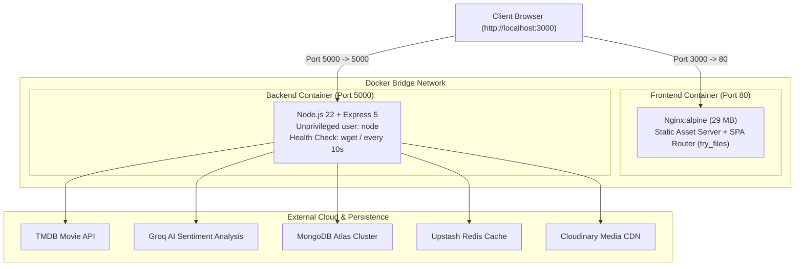

# CineReview 🎬

[](https://github.com/vishwajeetsali/cinereview/actions/workflows/ci.yml)


A full-stack, real-time movie review and discovery platform powered by TMDB metadata, Groq AI sentiment analysis, and Upstash Redis caching. Fully containerized with multi-stage Docker builds, unprivileged non-root runtime security, and automated CI/CD.

---

## ⚡ Quickstart with Docker Compose

Run the entire full-stack application (Frontend + Backend) with a single command:

```bash
# 1. Clone the repository
git clone https://github.com/vishwajeetsali/cinereview.git
cd cinereview

# 2. Start the multi-container stack
docker compose up -d --build

# 3. View live logs
docker compose logs -f
```

- **Frontend:** [http://localhost:3000](http://localhost:3000)
- **Backend API:** [http://localhost:5000](http://localhost:5000)

To shut down the stack cleanly:
```bash
docker compose down
```

---

## 🏗️ Architecture



---

## 🛡️ DevOps & Engineering Highlights

- **Multi-Stage Docker Builds:** Optimized frontend image from ~500 MB down to **29 MB** by using a temporary Node.js 22 builder and a razor-thin Alpine Nginx runtime.
- **Principle of Least Privilege:** Backend container drops `root` permissions and runs strictly under the unprivileged `USER node` (UID 1000).
- **SPA Route Resilience:** Configured Nginx with `try_files $uri $uri/ /index.html;` to eliminate 404 errors on browser client-side routing refreshes.
- **Automated Health Checks:** Express backend exposes an automated HTTP health check probe monitored by Docker engine with automatic retry policies.
- **CI/CD Automation:** Automated GitHub Actions pipeline validating 49 unit/security tests, TypeScript compilation, and multi-stage Docker build integrity on every push and pull request.

---

## 🧪 Testing

The test suite contains 49 automated tests spanning defensive security and end-to-end user journeys:

```bash
# Run backend security & unit tests
cd server
npm test
```
